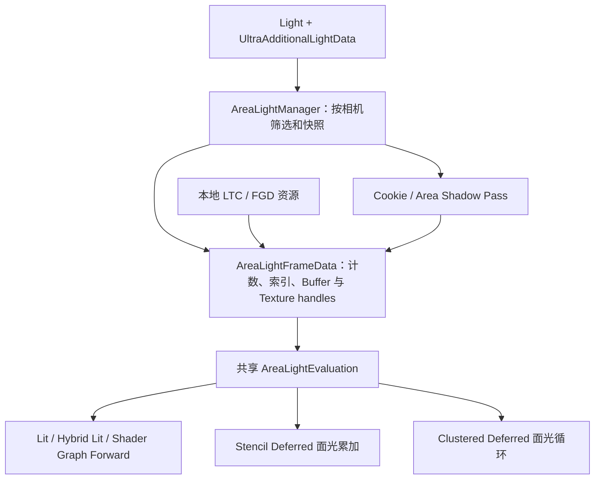

Hybrid Lit 与 Area Lights 迁移设计（源码评估，2026-10-28）
================================================================

可以迁移。推荐把上游的材质着色算法、矩形面光积分、Cookie 与阴影算法接入 FraxinusRP 已有的材质、灯光和 RenderGraph 框架。第一阶段采用共享 Area Light 评估函数、独立的小灯光列表，以及走 `UltraForwardOnly` 的新 Hybrid Lit 材质。

本文保留实施前的架构评估，核查基线为 FraxinusRP `ac205ec`、上游 `91495f7`；来源见 [README](../README.md#hybrid-光照来源与许可证)。文中新增类型和文件是设计建议。第一阶段的实际接口、支持范围和验证结果见 [HybridLighting.md](HybridLighting.md)，后续阶段仍是计划。

源码路径约定：`F/` 是当前工程的 `Packages/FraxinusRP/`，`I/` 是 README 中记录的上游源包根目录。

**当前基线和可复用资产。**

| 项目 | 核查结果 | 对迁移的影响 |
| --- | --- | --- |
| 版本 | 上游：Unity 6000.3.16f1、URP 17.3.0；Fraxinus：Unity 2022.3.62f3，包声明依赖自定义 Core 14.0.99 | 需要适配渲染入口、灯光 API、关键词及资源管理；仅替换 include 路径不足以完成迁移 |
| LTC 数据 | 两边 GGX、Disney、Charlie、KajiyaKaySpecular、CookTorrance、Ward、OrenNayar 共七张表，逐项比较后每张 16,384 个 ushort 数值完全相同 | 直接复用本地数据，无需复制或重新生成 LUT |
| LTC 生命周期 | `F/Runtime/UltraRP/UltraRenderPipeline.cs:296,332,708` 的 Build/Cleanup/Bind 均被注释 | 现有文件只是基础设施，尚无实时面光完整链路 |
| FGD | 已有 LUT 生成、资源注册和 RenderGraph import；主要消费者是 Cluster Deferred | 给 Forward/其他消费者补齐 import、读取声明和绑定 |
| 光照路径 | Forward、CPU Forward+、Stencil Deferred、GPU Clustered Deferred 共存 | CPU Forward+ 与 GPU Cluster 是两套列表，不能只修改其中一个 |
| 本机依赖 | `Packages/Fraxinus-RPCore` 是空目录；`packages-lock.json:166` 解析官方 Core 14.0.12，Library 中也为该版本 | 实施和编译验证前先恢复 [Installation.md](Installation.md) 指定的配套 Core；本次不修改依赖 |

本地基础见 [AreaLightSystem.cs](../Runtime/UltraRP/LightLoop/AreaLight/AreaLightSystem.cs)、[AreaLightCommon.hlsl](../ShaderLibrary/Lighting/Common/AreaLightCommon.hlsl)、[PreIntegratedFGD.cs](../Runtime/UltraRP/PreIntegratedFGD/PreIntegratedFGD.cs)。LTC 数组含八个模型槽位，其中 Marschner 为未实现占位；第一阶段只需要 GGX/Disney。

**迁移范围应按能力拆分。**

| 上游能力 | 推荐处理 | 原因 |
| --- | --- | --- |
| Hybrid Lit：rough diffuse、GGX、微阴影、AO、FGD IBL | 抽取算法，在本地材质输入与光照框架上实现 | 源仍使用 URP LitInput，核心变化在 Lighting/BRDF/GI |
| Rectangle LTC、range、light layers、clear coat 适配 | 迁入公共 Area Light 库 | 普通 Lit、Hybrid Lit 和 Deferred 应共享同一套面光数学 |
| Cookie atlas、过滤 mip、barn door | 分阶段迁入 Area 子系统 | 需要独立资源和过滤契约 |
| Area shadow atlas、EVSM、PCSS | 复用数学，重写剔除与 Pass 集成 | 源依赖 Unity 6 阴影 API，目标有自己的 2022 兼容实现 |
| 上游 RendererFeature、InternalBridge、Universal FrameData | 用本地模块、FrameData 和资源设置替代 | Fraxinus 是独立管线，已有原生调度和相机上下文 |
| ForwardGBuffer、SSR/SSGI、WetSurface、OIT、路径追踪 | 作为独立功能设计 | 不属于矩形面光的必要依赖，整包引入会改变 GBuffer、stencil、透明排序和曝光链路 |

源关键入口：`I/Shaders/Lit/Lighting.hlsl:36,134,206`，`I/ShaderLibrary/GlobalIllumination.hlsl:56`，`I/ShaderLibrary/AreaLight/AreaLightEvaluation.hlsl:331,383`。源 Hybrid Lit 的完整观感还受屏幕空间效果、环境贴图和曝光影响，完成基础材质迁移不等于获得所有这些效果。

**推荐的职责和数据流。**

继续使用 `FraxinusEngine.Rendering.Ultra` / `FraxinusEditor.Rendering.Ultra` 和现有程序集。让 Renderer 模块持有每 Renderer 的灯光缓冲及 atlas；LTC/FGD 作为共享只读资源，由管线生命周期管理。不要让多个相机共用未快照的可变灯光数组作为延后执行的 PassData。

拟议职责如下：

| 类型 / 层 | 职责与契约 |
| --- | --- |
| `UltraAdditionalLightData.AreaLights.cs` | 扩展现有附加灯光组件，存运行时宽高、Cookie、贡献系数、barn door 和阴影参数；不再创建第二套上游附加组件 |
| `AreaLightManager : IRendererModule` | 从当前相机灯光输入挑选 Rectangle，建立稳定索引和不可变帧快照；管理 buffer 容量、上限和 atlas 所有权 |
| `AreaLightFrameData : ContextItem` | 保存灯数、可见灯索引映射、面光/阴影 BufferHandle、LTC/FGD/Cookie/Shadow TextureHandle；`Reset()` 清零且句柄失效 |
| `AreaLightsPass` | 记录上传、Cookie、阴影与全局绑定；无阴影时只做必要准备，关闭时仍重置绑定 |
| `AreaLightEvaluation.hlsl` | 只负责矩形积分及可选 Cookie/阴影，不直接访问某个 Forward/Deferred 专用材质结构 |
| 材质适配器 | 将本地 BRDFData / Deferred 解码数据转成 AreaBSDFData、AreaPreLightData；输出独立 diffuse/specular 贡献 |

调度接入 `F/Runtime/UltraRP/Processing/UltraRenderer.cs:341` 的每相机准备过程及 `SetupRenderGraphLights`。只需要上传的部分可直接在现有灯光准备入口记录。Cookie/阴影可以使用 `InjectPass` 在主作用域 `RenderDrivenPass` 前执行，确保所有对象光照前已准备好；它们不依赖相机深度，不应复制 Contact Shadows 的深度前置要求。

若采用注入方案，先确认图存在有效注入点；缺少入口时应保持中性状态并提示配置问题。不要把失败的面光准备推迟到 PostProcess，因为该时刻对象照明已经结束。阴影修改 view/projection、viewport 等状态后，须通过现有 Renderer 相机设置恢复；目标直接能获得 `ScriptableRenderContext`，无需搬源端捕获 `beginContextRendering` 的绕行逻辑。

所有消费者都显式声明 `UseBuffer` / `UseTexture`：普通 DrawObjects、RenderingLayers 分支、透明物体以及两种 Deferred。上传、Cookie 写入、阴影写入与读取必须形成 RenderGraph 依赖。全局 texture/buffer 绑定用于 Shader 可见性，不能替代依赖声明；外部 atlas 每张图只导入同一份句柄。

**Hybrid Lit 的材质接入。**

推荐新增 `Ultra Render Pipeline/Hybrid Lit`，底层继续使用本地 `LitInput.hlsl`、`SurfaceData`、材质属性名和 BaseShaderGUI；新增着色代码放到共享库。这样可以逐个材质比较新模型，避免一次性改变所有旧 Lit 的普通灯光与环境反射。

| Shader 契约 | 目标要求 |
| --- | --- |
| RenderPipeline | `UltraPipeline` |
| 首阶段光照 Pass | `UltraForwardOnly`，参照本地 Complex Lit；在 Deferred 图里也由 ForwardOnly 节点绘制 |
| 材质分类 | 若保留辅助 GBuffer，用现有 `UltraMaterialType=ComplexLit` 的 skip-lighting 约定，或显式增加相应映射 |
| GBuffer LightMode | 目标实际仍使用 `UniversalGBuffer`，不要机械改成 `UltraGBuffer` |
| 配套 Pass | 保留本地 ShadowCaster、DepthOnly、DepthNormalsOnly、Meta、MotionVectors 与 alpha clip 规则 |
| GUI / 构建 | 从本地 LitShader/BaseShaderGUI 扩展；检查 ShaderID、属性迁移、变体声明和 stripping |

`F/Runtime/UltraRP/Passes/InternalPasses/GBufferPass.cs:88` 会把未知材质类型按 Lit 兜底处理。直接写 `UltraMaterialType=HybridLit` 并保留 GBuffer 会有重复照明风险。现有 ComplexLit 的辅助 GBuffer、深度法线和 ForwardOnly 路由应成套沿用。标准示例图已有 ForwardOnly 绘制，自定义图仍需核对该节点和透明队列。

源 `HybridLitForwardGBufferPass.hlsl:12,36` 只写 smoothness 和 normal，并服务 SSR/SSAO stencil；它不是目标的 Deferred GBuffer。第一阶段不替换本地 MRT 格式，也不占用用户 stencil 位。

Hybrid 的光照变化放在可单独调用的函数中，沿用目标已有常规灯光索引、lightmap、APRT、Contact Shadows 和反射探针输入。源 `I/ShaderLibrary/LightingData.hlsl:74` 在材质末尾乘曝光纹理，目标曝光在后处理完成；不能复制该乘法。源 `_CLUSTER_LIGHT_LOOP` 对应的循环也需要改接目标 `_FORWARD_PLUS`，不能原样照抄。

FGD 复用目标接口：目标 diffuseFGD/reflectivity 是标量，源部分调用为 float3，需调整调用点；不能同时 include 两套同名 FGD 函数。先保持两种模型的函数边界，再通过材质选择决定普通直接光与 IBL 用哪个模型。

Area Lights 应独立接入本地公共 `UniversalFragmentPBR`；因此普通 Lit 也能接收面光。Shader Graph 的 Forward 同样调用该入口，但仍要更新其生成的关键词、Shader target/平台限制和 stripping，不能仅凭共用函数就宣称已经支持。

**Area Lights 首阶段的数据与可见性。**

第一阶段限定矩形、单面、少量灯光、无 Cookie/阴影的闭环。可以先采用与源相同的 16 灯上限，但这是初始预算，不是本地管线的既定硬限制。选择灯光时要有稳定顺序/优先级并报告溢出，避免随剔除顺序变化而闪烁。

源 `AreaLightManager.cs:118` 从 `visibleLights` 取 Rectangle，没有独立场景注册表。目标首先验证 Unity 2022 的 Realtime Rectangle 是否进入当前相机 `CullingResults.visibleLights`。不能从源 Unity 6 行为推断本机引擎结果。如果没有进入，需通过现有附加灯光组件维护矩形灯登记与相机裁剪，并单独解决阴影 caster 的来源；不要伪装成 Point 后混用普通灯光索引。

Unity 2022 的 `VisibleLight` 没有源代码依赖的 `areaSize`；本机引擎 API 文档将 `Light.areaSize` 标为 Editor only。因此运行时宽高应序列化在 `UltraAdditionalLightData`，编辑器同步灯光尺寸，GPU 数据与阴影投影从附加数据读取。必须在 Player 验证尺寸保存，不能只验证 Inspector。

CPU/GPU 数据使用同一可生成的结构定义，明确 16 字节分组、stride、坐标空间、width/height 是否为全尺寸、normal/right/up 方向、light layers、shadowIndex=-1、Cookie 无效标志。首阶段使用绝对世界坐标，不能因源字段名叫 positionRWS 就隐式改成相机相对坐标。

现有普通灯光列表需保护：`ForwardLights.cs:518,545` 上传时仅排除主灯；`LightCoreBase.cs:39` 会将 Rectangle 当成普通位置灯处理。经典 Forward 的 per-object map 虽已排除不支持类型，CPU Forward+ 及后续列表仍需审计。简单加一个 `continue` 压缩灯光 buffer 会破坏 Shadow/Cookie 的索引契约。

应统一管理 `visibleLightIndex → punctualIndex / areaIndex / shadowIndex / cookieIndex`。保留原始 `CullingResults` 索引；第一阶段可以保留普通 buffer 的原槽位并将 Rectangle 贡献清零，同时从普通 tile/bin 和 per-object 列表排除。这样仍占普通可见灯预算，属于阶段性代价。若选择压缩，则必须同时修改计数、CPU/GPU 列表、Cookie、阴影和主灯偏移映射。面光不能再被普通点光循环计入一次。特别回归正交 Forward+ 和常规阴影的空 atlas 回退路径，两者与常规路径的类型过滤/索引处理并不完全相同。

无面光的相机也提交零灯数和有效的中性资源，防止 SceneView、Game、Preview、反射相机与 Base/Overlay 串状态。同视角子 Context 可以继承只读面光列表和 atlas；各消费者仍声明读取。以后如按子 Context 重建列表，应扩展 Begin/End 的绑定与恢复，并与它自己的 Cluster 网格一起切换。

**Deferred 的接法和边界。**

先将“面光支持普通 Lit”和“Hybrid 材质原生 Deferred”作为两个不同工作项。前者不要求改变基础 GBuffer；后者需要决定是否保留旧 Lit 模型、如何标记新模型以及是否需要 clear coat 等额外数据。

| 路径 | 推荐接入 |
| --- | --- |
| Forward / Forward+ | 在共享 PBR 入口每像素预计算 LTC/FGD，再循环相机小列表；透明材质走同一入口 |
| Stencil Deferred | 单独一次面光累加 Pass，或新增专门的面光 draw 分支，使用同一 evaluator；不要放进每个 punctual light 的循环，否则面光会按普通灯数量重复累加 |
| Clustered Deferred | 在 `DeferredLit.compute` 解码材质后加一次 Area 循环；第一版可用同一小列表，随后接 `LightCategory.Area` |
| Hybrid Lit 原生 Deferred | 基础金属/粗糙度算法未必需要扩展 MRT；若与旧 Lit 共存需定义模型识别，扩展参数才考虑编码变化。没有实现对应解码和着色之前继续走 ForwardOnly |

Stencil Deferred 必须处理 framebuffer-fetch 与纹理采样两种配置。如果选独立 fullscreen 面光累加，需要可采样 GBuffer/深度及有效的材质遮罩，必要时像现有 Contact Shadows 一样禁用 framebuffer fetch；同时排除 Unlit 和已经由 ForwardOnly 照明的像素，避免重复累加。记录额外带宽和 pass 成本。

GPU Cluster 已预留 `LightCategory.Area` 和 Area feature bit，但 `GPULights.cs:106` 的 Rectangle、`GPULightsDataBuildSystem.cs:590` 的 bounds 均是注释；当前打包结构也缺少完整矩形基向量与宽高。后续需要独立面光数据、矩形影响范围、分类计数、索引映射和调试显示。CPU Forward+ 则要单独实现面光列表优化。

源 `ShaderVariablesAreaLights.hlsl:31` 将 `_AREA_LIGHTS` 绑定到 `AREA_SHADOW_MEDIUM/HIGH`，并限定 fragment。目标拆成独立的“启用面光”与“阴影模式”，评估函数允许 fragment/compute 使用；无阴影面光也能工作。

源 `AreaLightEvaluation.hlsl:524` 为匹配 URP 将 diffuse/specular 乘 PI。抽取原始积分与各路径的能量适配，按目标 Forward/Deferred 的 BRDF 约定校准；不要因两边有 HDRP 源码就盲目删除，也不要不检查就重复乘。粗糙度、NdotV、面积、距离的对照场景应固定曝光。

**Cookie 与阴影的第二步集成。**

Cookie 保留源 PowerOfTwo atlas、padding 和过滤 mip 的设计，挂到本地 runtime resources。普通点光 Cookie atlas 没有相同过滤契约，先用独立 Area atlas。执行顺序为 reserve/layout → filter/fetch → 确定 scale-offset → 上传灯光数据 → 着色读取，避免在 RenderGraph record 阶段提前上传尚未确定的 atlas UV。

阴影复用矩形投影、atlas 分配、EVSM/PCSS 算法，重写 Unity 2022 入口。本地 [ShadowCulling.cs](../Runtime/UltraRP/Shadow/ShadowCulling.cs) 明确没有 Unity 6 的 `ScriptableRenderContext.CullShadowCasters`；现有 `AdditionalLightsShadowCasterPass.cs:810` 使用 `ShadowDrawingSettings.splitData` 加 `CreateShadowRendererList`。矩形支持要沿此接口验证投影与 caster 剔除，不能直接搬源 `splitIndex` 和二次 CullShadowCasters。

如果矩形只能从自建登记表获得而没有 native visibleLightIndex，就不能直接使用该 ShadowDrawingSettings 路径，需要独立的灯光视角剔除/ShadowCaster 绘制方案。另需修改 `UltraRenderer.cs:296` 的阴影剔除开关：当前关闭 main/additional shadows 就会移除 `CullingOptions.ShadowCasters`，独立 Area shadows 必须计入判断，并明确其阴影距离策略。

源阴影用后移的透视投影近似矩形发光面，Medium 为 EVSM，High 为 PCSS，并非路径追踪意义上的精确面积阴影。验证需要包含离屏遮挡物、近裁面、反向 Z、alpha clip、偏移、atlas 溢出和相机状态恢复。若现有 cullResults 不包含所需 caster，必须补足灯光空间剔除；单改采样器不能解决缺失遮挡物。

发光代理 mesh 仅作为可选灯具可视化，最后迁入；照明计算不依赖该 mesh 存在。

**预计涉及的文件。以下新增路径为设计建议。**

| 操作 | 文件或目录 | 内容 |
| --- | --- | --- |
| 扩展 | `Runtime/UltraRP/LightLoop/AreaLight/AreaLightSystem.cs` | 幂等/引用计数生命周期、RTHandle import 与释放；保留已有数值表 |
| 新增 | `Runtime/UltraRP/LightLoop/AreaLight/AreaLightManager.cs`、`AreaLightData.cs` | 相机列表、映射、GPU 结构与生成的 HLSL |
| 新增 | `Runtime/UltraRP/UltraAdditionalLightData.AreaLights.cs` | 运行时尺寸和面光参数 |
| 新增 | `Runtime/UltraRP/FrameData/AreaLightFrameData.cs` | 每相机快照、buffers/textures 和 Reset |
| 新增 | `Runtime/UltraRP/Passes/InternalPasses/AreaLightsPass.cs` | 上传、绑定及后续 Cookie/阴影调度 |
| 修改 | `UltraRenderPipeline.cs`、`Processing/UltraRenderer.cs`、`LightLoop/ForwardLights.cs` | LTC 生命周期、相机准备、普通灯光过滤与索引一致性 |
| 新增 | `ShaderLibrary/Lighting/AreaLight/` | evaluator、变量、材质适配和可选阴影接口 |
| 修改 | `ShaderLibrary/Lighting.hlsl`、`Passes/DrawObjectsPass.cs` | 普通 Lit/透明物体消费与资源依赖 |
| 新增 | `Shaders/HybridLit.shader`、`ShaderLibrary/Lighting/Hybrid/` | 本地材质外壳与增强 BRDF/GI，保留本地配套 Pass |
| 修改 | `Passes/InternalPasses/DeferredPass.cs`、`Shaders/Utils/StencilDeferred.shader`、`Shaders/Utils/StencilDeferred.hlsl`、`Shaders/Lighting/DeferredLit.compute` | 两种 Deferred 的独立面光接入与资源声明 |
| 后续修改 | `LightLoop/Cluster/GPULights.cs`、`GPULightsDataBuildSystem.cs`、相关 cluster HLSL | 面光 bounds、分类与 GPU 列表 |
| 扩展 | `RenderPipelineResources/UltraRenderPipelineRuntimeShaders*.cs`、本地 Renderer/Pipeline 设置 | 注册过滤 Shader、阴影 Compute、资源预算和变体能力 |
| 修改 | `Editor/UltraRPEditor/Light/UltraRenderPipelineLightUI.*` | Rectangle 实时参数、运行时尺寸同步、layers/阴影 UI；Disc 按实际实现能力保留原行为 |
| 修改 | `Editor/UltraRPEditor/BuildProcessors/UltraRPProcessScene.cs`、ShaderGUI、ShaderGraph、ShaderStripping | 修正仅支持 Baked 面光的构建提示，接入新材质与关键词 |

Inspector 的现有强制逻辑位于 `LightUI.Drawers.cs:187–193`；必须修改，不能只改“baked only”文字。`UltraRPProcessScene.cs:53` 目前只是警告，不会删除或转换 Rectangle，但也需按新能力更新。没有附加数据时使用明确默认值或要求编辑器补齐，避免像源 Manager 那样在相机绘制中自动 AddComponent 改动场景。

**实施顺序与验收口径。**

| 阶段 | 交付边界 | 必须验证 |
| --- | --- | --- |
| 0：基线与引擎接入 | 恢复匹配 Core，确认现有示例可编译运行；验证 Rectangle 可见性和 Player 尺寸 | 先区分原有环境问题与迁移问题，确定相机收集和阴影 caster 方案 |
| 1：首个闭环 | Hybrid Lit ForwardOnly；普通 Lit/Hybrid 共用无阴影矩形面光；LTC/FGD 生命周期与帧数据 | Forward/Forward+、粗糙度/金属度、clear coat、alpha clip/透明、零灯/关灯、layers、两相机、子 Context、普通光索引无回归 |
| 2：跨路径面光 | Stencil 与 Clustered Deferred 的普通 Lit 接收面光；Hybrid 暂保留 ForwardOnly | 同场景路径切换、无重复光照、Unlit 排除、framebuffer fetch 配置、材质遮罩、资源读写声明 |
| 3：完整面光功能 | Cookie、EVSM/PCSS 阴影、barn door 与可选发光网格 | 动态 Cookie、离屏遮挡物、atlas 溢出、反向 Z、灯光销毁、相机恢复和性能预算 |
| 4：优化和材质扩展 | 按性能证据决定 GPU Area cluster、CPU Forward+ 面光列表、Hybrid 原生 Deferred | 多灯压力、GPU 时间/内存/变体数量、模型识别及材质兼容 |

阶段 1 首先在当前项目主要使用的 Windows/D3D11 验证，再验证实际需要的平台。运行时 StructuredBuffer 和面积灯计算要求审查 shader target；不能直接保持旧 Lit 的所有低端目标声明并承诺兼容。Shader Graph、Player 变体裁剪和材质引用必须在实际构建中验证；IL2CPP、XR 和其他 API 仅在实际测试后声明支持。

保留固定曝光的金属/粗糙度球阵列和矩形灯测试场景，分别比较旧 Lit、新 Hybrid、不同光照路径及面光开关；回归本地 APRT、Contact Shadows、Auto Exposure、Depth Priming、MSAA、运动矢量与 TAA。检查 RenderGraph 生命周期、域重载和管线切换后的资源释放。移入的代码保留原作者及 Unity/HDRP 来源说明，遵循源仓库的 Unity Companion License。

设计时完成了源码路径核查、跨项目数据流对照，以及七张 LTC 数值表的逐项比较。后续第一阶段已经实现并完成部分验收，实际交付范围以 [HybridLighting.md](HybridLighting.md) 为准；本文后续阶段仍为设计计划。
