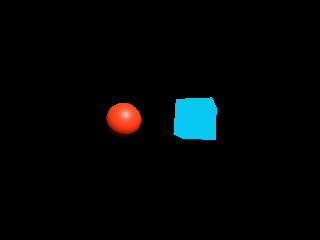
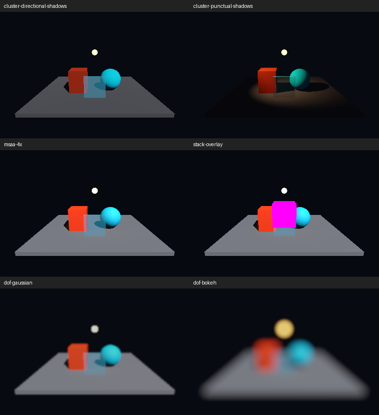

# Unity 2022 validation

This document is a historical evidence record. The migration validation scripts
and their menu/batch entry points were removed on 2026-10-22 to reduce package
maintenance. Earlier published source tags retain those tools; the Inspector
regression's local evidence is under `Logs/FraxinusRP/AssetInspector-2026-10-22`.
Commands and source paths below describe the tested snapshots, not current
package entry points. Summary JSON files retain their original evidence hashes.

Example scenes and their Editor generators were also removed from the published
package on 2026-10-29. Earlier source checkpoints retain the corresponding test
fixtures; use [Installation.md](Installation.md) for current asset-creation steps.

Environment: Unity **2022.3.62f3**, Windows, NVIDIA GTX 1650, Direct3D 11,
Fraxinus-RPCore **14.0.99**, local Shader Graph **14.0.12**. Source Engine
commit: `bf25c32`. Logs and captures are under `Logs/FraxinusRP` in the host
project. Results distinguish compilation, Editor rendering and standalone runs.

## Render allocation fixes (2026-10-27, unreleased)

Unity 2022.3.62f3 validation in the host project recorded the following results:

- Texture-handle identity: 81 pairwise comparisons and eight contact-shadow
  eligibility cases passed. After warmup, 10,000 actual eligibility calls
  changed from 160,000 allocation events to zero.
- APRT collection: native ordering, the four-light limit, live radiometry,
  creation/destruction, activation, light types, hide flags and cleanup passed
  in Edit Mode. Warmed calls and collections immediately after repeated visible
  and excluded light property changes produced zero allocation events. The
  `GC.Alloc` recorder detected an intentional allocation as a positive control.
- The current scene's render-loop subtree recorded zero `GC.Alloc` bytes over
  30 consecutive Play Mode frames. This does not cover the entire Editor frame,
  every renderer configuration, startup or scene membership changes.
- Editor recompilation passed. Independent C# compilation passed for the bridge
  and URP in Editor/Player, and Fraxinus.Runtime in Player with and without
  `ENABLE_VIRTUALTEXTURES`. These checks are not standalone Player execution.

Local evidence: `Temp/TextureHandleGC-result.txt`,
`Logs/FraxinusRP/RemainingRenderAllocations.txt`,
`Logs/FraxinusRP/RenderLoopAllocations.txt` and
`Temp/TextureHandleGC-BridgeValidation/` in the host project.

There is no current full-scene CPU/GPU before/after comparison. Light tracking
retains state proportional to light count, processes changes and checks
directional-light hide flags. Frequent membership changes still allocate and
can add CPU work; collection capacities retain their peak until disposal.

These are historical measurements from before the local repository was lost.
The 2026-10-27 recovery restores the production changes from original backups
and recorded patches. Temporary profiling and regression scripts are not
included in the recovered package, and the recovery does not repeat or extend
the earlier performance measurements.

Validation also caused an Editor stall while Editor/deep profiling recorded the
temporary capture tooling. Stopping recording alone left Deep Profile enabled.
Recovery disabled both profiling modes and cleared captured frames; temporary
capture/recovery scripts were removed. Do not use that capture approach for CPU
timing. Future timing comparisons should use an isolated project or Player with
matching settings and deep profiling disabled.

## Bloom allocation fix (2026-10-23, unreleased)

`Logs/FraxinusRP/BloomGC-2026-10-23/Validation.json` records Unity 2022.3.62f3
validation of the exact `PrepareUberPostBloom` method through a cached delegate.
After warmup, 10,000 calls produce zero `GC.Alloc` events; an intentional array
allocation produces one event in the same recorder. Snapshot independence and
all four disabled Bloom keywords pass. Scene, pipeline and Play Mode state are
preserved. This measures this method, not whole-frame or Player allocations.

## APRTV integration (2026-10-23, unreleased)

Local evidence is under `Logs/FraxinusRP/APRTVIntegration-2026-10-23`.
`Contracts-01.json` passes backend parameters and independent APV/APRTV
prefiltering for all three probe-system selections. Unity 2022.3.62f3 recompiles
the runtime and Editor assemblies successfully; direct Editor and non-Editor
Release C# compilation also passes. Release compiler evidence is under
`Logs/FraxinusRP/APRTV/compile-release`.

`Graphics-12-Production.json` passes 60 checks on D3D11 with real GPU readback;
the consecutive `Graphics-13-Production.json` repeat passes 66 checks, adding
independent compute ownership and destruction on pipeline disposal in each mode.
Forward, stencil Deferred and Clustered Deferred each render Lit, Simple Lit,
Baked Lit and UltraRP Lit Shader Graph receivers with a synthetic APRT baking
set. GI on/off/on changes and restores
receiver pixels; outputs are finite, the APRT keyword is active with APV keywords
disabled, an empty baking set disables sampling, and switching pipelines clears
APRT state. Changing a live directional light's color and intensity changes both
rendered pixels and the runtime GPU SH buffer. No runtime errors are recorded.
The clean active scene and original quality-selected pipeline are preserved.

`Shaders-03.json` passes 11 checks after importing and warming APRTV material
variants and both Lit/Specular Shader Graph assets. The generated graphs include
the shared probe-volume variants and declare the APRT keyword; their passes
compile without ShaderUtil errors. Earlier shader-fixture requests combined
keywords absent from the graphs and are retained as rejected runs.

Earlier graphics runs are retained: PreviewScene and DontSave test lights were
excluded by the public scene-light query, and one fixture used a Play Mode-only
scene API in Edit Mode. These rejected runs do not count as live-light acceptance.
Repeated runs also exposed stale GPU output from Core's shared relight
ComputeShader. A direct dispatch with identical inputs and an independent shader
instance produced correct SH output. The paired Core fix owns and releases one
shader instance per APRT runtime; production acceptance uses that fix without a
test-injected shader instance. The final local `Acceptance.json` records accepted
report hashes, fixture cleanup and ProjectSettings restoration.

This verifies runtime integration with synthetic data, not a new end-to-end APRT
bake or a Player build. IL2CPP, XR, other graphics APIs, sky capture, multiple
baking sets and camera-stack image correctness were not reaccepted in this run.
The public light query allocates an array per relevant APRTV camera.

## RenderGraph exception boundaries (2026-10-23, unreleased)

The paired RPCore removes per-pass exception wrappers and async submission
catch blocks, keeps buffer ownership until submission succeeds, and flattens
graph cleanup. Immediate mode retains a recording-time exception boundary.
Evidence is under `Logs/FraxinusRP/RenderGraphExceptionCleanup-2026-10-23`.

`ExceptionAcceptance.json` accepts 11 contextless fault-injection cases across
native/legacy raster, compute, unsafe, async callback and immediate execution.
Each preserves the original exception, clears graph/typed-context state,
returns temporary arrays/material blocks and async buffers, then successfully
reuses the same graph. Six existing immediate-mode assertions are recorded
separately and their origins verified against the full Editor log. Preliminary
runs that misclassified these assertions remain in the evidence directory.
This tests managed recovery before submission; it does not verify actual async
GPU submission failures or interruption of an open native render pass.

`GraphicsAcceptance.json` passes 11 cases / 132 Play Mode frames / 144 camera
samples, including 101 native samples, with zero errors on Unity 2022.3.62f3 /
D3D11. Forward, Clustered Light Layers and 4x MSAA native on/off captures match
across all 1,179,648 compared float channels. Both GameView checks pass command
and attachment execution; screen pixels and pure-depth RT pixels are not read.

`ReleaseCompile-Accepted` compiles four runtime assemblies from 561 current
sources with zero errors and three existing unused-variable warnings. This is
Release C# compilation, not a Player build. Accepted snapshots include the
concurrent Bloom update. `Acceptance.json` verifies source identity, all 48
restored ProjectSettings files, removed temporary Assets and exited test Editors.

The four changed files have 35 to 20 explicit `try` statements, 26 to 19 `catch`
clauses and 16 to 6 `finally` clauses. Failure-only native closure and resource
quarantine remain protected. These counts exclude compiler-generated regions
from `using`; no CPU frame-time improvement has been measured. Unity 6 received
source review only, including its native SetRenderTarget guard reset.

## Unified native pass compiler (2026-10-23, unreleased)

NativePassCompiler now contains the shared execution flow and engine API
branches; the separate 2022 partial and its meta file are removed. Descriptor
fallbacks live in PassesData. Submission ordering, deferred graphics fences,
foveation cleanup and backbuffer depth conversion retain their prior behavior.

Evidence is under `Logs/FraxinusRP/NativePassUnified-2026-10-23`.
`GraphicsAcceptance.json` passes 11 cases / 132 Play Mode frames / 144 camera
samples, including 101 native samples, with zero errors on Unity 2022.3.62f3 /
D3D11. It repeats Forward, stencil Deferred, Clustered Light Layers, pure depth,
SGSR2, 4x MSAA and both GameView checks. Each of the three native on/off RT
comparisons covers 393,216 float channels with zero difference.

`ReleaseCompile/Summary.json` compiles all four runtime assemblies from 561
current source files without Editor defines or references: zero errors and
three existing unused-variable warnings. This is C# compilation, not a Player
build. Source hashes match the tested runtime files. Test settings are restored
and temporary Assets are removed; no validation code is added to the packages.

Unity 6 received source/API-branch review only, not compilation or runtime
acceptance. GameView verifies execution/errors, not screen pixels; pure-depth
RT has no depth readback in this repeat. The depth-content fixture below was
not rerun for this compiler consolidation, and its original evidence is retained.

## Native depth submission and copy refactor (2026-10-23, unreleased)

At this checkpoint, the Unity 2022 backbuffer conversion was confined to its
submission adapter. Depth copies derive their configuration from
source/destination resources, snapshot camera values and bind the final output
color/depth pair explicitly. Per-camera copy flags and their cleanup reset are
removed.

GPU controls also reproduced a shared-material bug with native rendering both
enabled and disabled. Recording two copies from different RFloat sources before
submission made both draws sample the second source. A single-copy control and
the source upload were correct. The fix records source texture and texel-size
bindings in command order and uses two materials with fixed ZWrite states,
allocated once at helper initialization.

Local evidence is under `Logs/FraxinusRP/NativePassRefactor-2026-10-23`.
`GPU-Depth-Content-05/Report.json` passes native on/off in one process, each
recording 15 production copies with one DepthCopyPass instance, including 12
copies in a single graph. All 24,948 compared float values/color channels have
zero error against expected values. Checks cover distinct consecutive sources,
RFloat/depth round trips, 4x MSAA depth sampling, a partial final viewport with
preserved exterior depth and color, a following ordinary copy, and SceneView/
Preview camera-type attachment handling. The native main graph compiles seven
native passes; no graphics errors occur.

The final production code also passes `GraphicsAcceptance-Final.json`: 11 cases,
132 real Play Mode frames, 144 camera samples including 101 with native
compilation, and zero errors. The RT matrix covers Forward, stencil Deferred,
Clustered Light Layers, pure depth, SGSR2 and 4x MSAA. Forward, Clustered and
MSAA native on/off captures each compare 393,216 float channels with zero
difference. Two cameras share a renderer and alternate ordinary RT depth copies
with final GameView copies; SGSR2 GameView also passes with Gizmos and UI.

This content fixture uses a temporary pipeline with a real rendering context
and the production CopyDepth shader injected into the production helper. It
does not open actual SceneView/Preview windows or read the screen backbuffer.
Runs 01-03 retain the shared-material failure and controls. Run 04 verifies the
fix but rejects a 2:1 point-sampling expectation at texel boundaries; run 05 uses
a 3:1 viewport with samples at texel centers, keeping the original tolerance.

`ReleaseCompile-Final/Summary.json` compiles four runtime assemblies from 562
current source files against Unity 2022 Windows Standalone references, with no
Editor defines/references and zero errors. Three existing unused-variable
warnings remain. This is C# compilation, not a Player or IL2CPP build.

`Acceptance.json` records the accepted report hashes, production-source checks
and cleanup. All 48 host/isolated ProjectSettings files match their saved hashes;
temporary Assets were removed. No test code is shipped in the packages. Unity 6
runtime, other graphics APIs and Player rendering were not revalidated here.

## Native render passes: initial fix (2026-10-23, unreleased)

This fix spans FraxinusRP and the paired RPCore native compiler. The host Editor
log records `BeginRenderPass: Cannot use color-only surface as depth attachment`,
followed by subpass errors. The initial verification used the corrected native-only
depth binding, the final depth-copy color attachment, and the updated Gizmos
depth target. Earlier unsuccessful and interrupted runs remain in local evidence.

Nine cases pass 108 real Play Mode frames on Unity 2022.3.62f3 / D3D11, with 78
frames explicitly recording native compilation enabled:

- GameView with Gizmos and UI: ordinary rendering and SGSR2 each pass 12 frames,
  including the final depth copy, with no graphics errors or crashes.
- A single-process RenderTexture matrix passes Forward direct rendering with
  native on/off, stencil deferred, Clustered Light Layers with native on/off,
  pure-depth rendering and SGSR2. Each case renders 12 frames.
- Forward and Clustered Light Layers on/off color captures are finite and
  nonempty; all 393,216 float channels in each comparison match exactly.

GameView checks establish command and attachment execution without errors, not
screen pixel correctness. Pure-depth output is checked for native execution,
without depth pixel readback. This round does not rebuild a Player or cover
other graphics APIs. At this checkpoint production sources matched the accepted
snapshots; all 48 host and isolated ProjectSettings files matched their saved hashes. The
temporary fixture was removed from the isolated project and is not shipped.

Local evidence is under `Logs/FraxinusRP/NativePass-2026-10-23`; the accepted
`Acceptance.json` has SHA-256
`19349bb1814c7071fe17cb3393e72eb1cb34a52c4261de5de2c162f5fbb0c38d`.

## SGSR1 and SGSR2 (2026-10-23)

Source tag: `unity2022-checkpoint-2026-10-23`. The Editor GPU check passes 43
Play Mode frames, and a Windows Mono Player build and 20-frame RenderTexture
smoke test pass. Scope, report hashes and limitations are in
[Upscaling.md](Upscaling.md). All 48 host and isolated ProjectSettings files
match their saved hashes; temporary test scripts were removed from the isolated
project and are not shipped in this package.

The local evidence summary is `SGSR-2026-10-23/Acceptance.json`, SHA-256
`373a3ff175b6af840bd54d14f0e3c8400284652cc7546ea4a5a886086d6999f9`.
Before submission, trailing whitespace was removed from new shader and meta
files; production content otherwise matches the tested source snapshot.

## Validation tooling cleanup (2026-10-22)

Published as `unity2022-checkpoint-2026-10-22`, using Core
`038ad6278a1f92195b654724a78d92865a6017d5`.

The cleaned Editor assemblies compile without the removed validation types.
An isolated one-off check generated all six advanced scenes and their pipeline
assets with no missing scripts, rendered the simplified Basic Forward sample
into a RenderTexture (851 orange and 1,679 cyan pixels), and confirmed sample
settings restoration and the presence of production build processors.
`ValidationCleanup-2026-10-22/CompileAndSamples-02.log` exits 0; all 48 host and
isolated ProjectSettings files match their saved hashes. Runtime source is
unchanged, and no Player build was repeated for this cleanup. The check is kept
with local evidence and is not shipped in the package.

Accepted report SHA-256 values (paths relative to `Logs/FraxinusRP`):

| Report | SHA-256 |
| --- | --- |
| `ValidationCleanup-2026-10-22/Accepted.json` | `1bd9f7269cc13d5d58880c8c2d01ae04f71b1aa399945d24c51cb7780e8602ec` |
| `AssetInspector-2026-10-22/After-01.json` | `713fcac76ad74a04cac83d9bdd1d70d83f9df6a3e5c3e320fb73ae90f0be3a14` |

## Inactive pipeline asset Inspector (2026-10-22)

`FraxinusEditor.Validation.UltraRPAssetInspectorValidation.Run` exercised the
actual Rendering drawer inside an EditorWindow's IMGUI Layout/Repaint events.
It selected Built-in and a temporary URP asset, each with either a Forward graph
or three Forward/Deferred/Clustered graph slots, with Ultra runtime shaders
unavailable. It checked that drawing created no renderer instances and changed
neither pipeline selection nor global-settings registration.

Evidence is under `Logs/FraxinusRP/AssetInspector-2026-10-22`. `Before-01` exits
1 and records the original GPULights.cs:469 NullReferenceException in all four
cases. `After-01` exits 0; all four cases complete Layout and Repaint without
exceptions, with zero renderer instances and settings restored. The temporary
entry point wrote `Library/FraxinusRP/AssetInspectorValidation.json` and was
removed after testing.

This is a synchronous Inspector regression with no pipeline instance running;
URP is selected but its rendering is not exercised. The change only removes an
inactive check's runtime-renderer creation from the Editor drawer. Runtime source
is unchanged; this follow-up does not repeat GPU rendering or Player acceptance.

## Unified context Get follow-up (2026-10-21)

Passes now use `frameData.Get<T>()` for current scope and shared items. The paired
Core ContextContainer resolves borrowed ScopeData directly; the manager switches
the binding at scope boundaries. The compatibility ContextData type uses that
same storage. Core containers without a scope retain ordinary owned-item behavior.

The published source tag is `unity2022-checkpoint-2026-10-21-get`, paired with
Core `038ad6278a1f92195b654724a78d92865a6017d5`. The portable
[UnifiedContextGetSummary.json](UnifiedContextGetSummary.json) records tested
source and report hashes. Full evidence is under
`Logs/FraxinusRP/UnifiedContextGet-2026-10-21`:

- `Regression-04.log` exits 0: 45 container checks plus all seven nested rendering
  scenarios pass. Checks cover overrides, fallback, Contains/GetOrCreate,
  missing/duplicate types, borrowed ownership, live growth/clear, nested parent
  reference restoration, reset and custom main-scope bindings.
- The positive allocation control produces one `GC.Alloc` event. One million
  scoped frame reads, one million fallback frame reads, one million manager
  reads, 10,000 bind/switch/reset cycles and 10,000 rendering lookup/injection
  cycles each produce zero events after warmup. The managed byte counter is
  unsupported on this Editor and reports -1 in the accepted reports.
- `Regression-03.log` also passes SG Forward/Deferred/Clustered graphics and
  30 pure-depth requests. The final change after that run adds custom main-scope
  binding support, covered by Regression 04. Both compile Runtime and Editor.
- `PipelineSwitch-02.log` passes actual URP -> UltraRP -> URP pixels and shader
  state in Editor Play Mode. The first run rejected an old missing GPU Batcher
  script in the isolated URP reference renderer. Run 02 used a plain reference
  renderer; its original bytes were then restored, with the change recorded in
  `PipelineSwitchFixture.json`.

All 44 host and isolated ProjectSettings files match their saved baseline.
This follow-up does not rebuild the Player or establish IL2CPP, XR, whole-frame
allocation behavior or platforms beyond the stated D3D11 environment.

## Allocation measurement correction

The unified Get follow-up added an intentional-allocation control and found that
this Editor's `GC.GetAllocatedBytesForCurrentThread` also returned zero for a
retained byte array. Historical zero-byte readings below, including the original
FeatureCompletionSummary, do not establish zero allocation. Current context
validation uses the Unity Profiler `GC.Alloc` recorder with a positive control,
reports allocation event counts, and marks unsupported byte counts as -1.

## Terrain and SpeedTree default shaders

`TerrainDefaults-2026-10-20` records this follow-up on the environment above.
The Release Runtime compile passes for all 258 source files; the isolated Editor
also compiles the Runtime and Editor assemblies. `TerrainDefaultsValidation.json`
passes default-resource lookup with UltraRP unregistered and registered while
Built-in is selected, checks all 13 shader-ID slots (SpeedTree 9 is reserved),
and requests 114 synchronous pass compilations across six shaders and 21 selected
material keyword combinations. No shader compiler messages are reported. Pipeline
selection, global-settings registration and the shader pipeline tag are restored.

`Graphics-04.log` exits 0. `TerrainDefaultsGraphics.json` passes 84 checks using
real TerrainData and native, non-instanced mesh, grass and billboard details in
Forward, Deferred and Clustered. The 63 render requests produce 27 captures and
nine off/on/off comparisons. Enabling details changes 11,444–11,966 pixels;
disabling them restores every pixel. No error-magenta or non-finite pixels and
no runtime errors are recorded. All 44 snapshotted ProjectSettings files across
the host and isolated projects are unchanged. `Acceptance.json` summarizes the
results; `TestedSourceHashes.json` identifies the seven implementation files.

The five enabled defaults are terrain detail mesh, grass, billboard grass,
SpeedTree 7 and SpeedTree 8. SpeedTree 8 uses the active hand-written shader;
SpeedTree 9 remains unavailable. Compilation does not establish real SpeedTree
model import, LOD transitions, animated wind or Player behavior. The selected
variants are recorded in the report and do not cover every keyword combination.

## Generic context storage

The subsequent context change is validated on Unity 2022.3.62f3 in
`ContextStorage-2026-10-20`. `Compile.json` records a successful Release compile
of all 258 Runtime source files with three existing unused-variable warnings.
`Validation.json` passes 21 checks: main/sub resource and camera isolation,
shared RenderingData, restoration after scope exit, borrowed-object ownership,
missing types, replacement, storage growth and cross-instance isolation.
`TestedSources.json` identifies the four context implementation files tested.

The historical `GC.GetAllocatedBytesForCurrentThread` measurement recorded **0 B** over
1,000,000 manager Get calls and **0 B** over 10,000 Clear/bind/scope-switch/Reset
cycles. These measurements exclude construction, initial generic/runtime setup
and capacity growth. They establish neither zero allocation for an entire frame
nor the absence of garbage collections caused by other code, and do not measure
IL2CPP allocation behavior.

The reusable package entry point is
`FraxinusEditor.Validation.UltraRPContextStorageValidation.Run`, also available
as **Tools/FraxinusRP/Validation/Validate Context Storage**. It writes
`Library/FraxinusRP/ContextStorageValidation.json` in the current project and
reports failure after saving the results. It does not change project assets or
settings. For batch use, pass `-executeMethod` with that entry point and `-quit`.
The packaged entry point was rerun successfully before upload:
`PackageValidation-01.log` exits 0 and `PackageValidation.json` repeats all 21
checks and the historical zero byte-counter readings; see the correction above.

The earlier lighting and Player results below predate the context change. They
remain evidence for their recorded source snapshots; this follow-up does not
repeat the complete graphics or Player matrix.

## Exception handling cleanup

The subsequent cleanup replaces expected adapter validation failures and a missing
error shader with explicit checks, narrows adapter exception isolation to extension
construction/enumeration, and simplifies build-state cleanup without removing the
post-build recovery boundary. `ExceptionCleanup-2026-10-20/Validation-01.log` exits
0: the existing ScriptableNode suite, 19 shader-diagnostic cases and two ordinary
Player build controls pass. The included invalid compute still fails the build;
the unrelated invalid compute permits a successful build. `Acceptance.json` in
that folder verifies all nine checks, including source identity, settings-byte
preservation and cleanup. The rendering captures below predate this cleanup;
this follow-up does not repeat the pixel matrix or measure a frame-rate change.

## Build diagnostics and Clustered lighting follow-up

The 2026-10-20 follow-up uses the same Unity/D3D11 environment. Evidence is under
`BuildLighting-2026-10-20`. These results extend the earlier checkpoint and
correct its Stencil Player runtime-error scope as described below.

- `Editor-02.log` passes actual renderer-declaration stripping checks, Shader Graph
  Forward/Stencil/Clustered rendering, and all 12 screen-shadow compute variants.
  Its first mixed-light cookie test fails and is not accepted as lighting evidence.
- `Editor-03.log` exits 0 after the mixed-light count correction. The diagnostics
  report contains 19 cases and 10 expected rejections, including real Shader,
  Compute and Shader Graph HLSL errors, graph validation errors that generate a
  compilable fallback, unrelated-asset isolation, cache reuse and API filtering.
  Deliberate negative controls emit compiler errors; these are expected.
- `Clustered-Accepted/PixelReport.json` passes 276 pixel checks and 685 count
  checks over 274 render requests, using a SimpleLit diffuse receiver. Its
  234 PNGs and 94 linear EXRs cover Spot projection/translation/
  rotation, main/additional Directional cookies, Point cookies on six faces,
  mixed-light ordering and first-frame cookie changes, independent light
  contributions, and hard Point shadows on six faces and three cross-face seams.
  Every Clustered capture checks actual uploaded counts and culling constants.
  PNGs compress HDR range for display; assertions use linear float readback.
- `PlayerErrorControls-01.log` exits 0 after two ordinary non-StrictMode Player
  builds. The unreferenced invalid compute does not block the successful build;
  including it through Resources produces the new production diagnostic report
  and a `BuildFailedException`, and BuildPlayer returns `Failed`. The report
  verifies exact settings-byte restoration and removal of temporary assets.

The mixed-light failure exposed a distinct count defect: `additionalLightsCount`
includes non-main directionals, but the local-light bounds do not. Clustered
culling and environment offsets now use the current frame's actual bounds.
The failing Point-cookie ratio changed from 0.60585 to 0.74965 (expected 0.75)
without widening the assertion tolerance. Spot projection no longer gets
overwritten by Point projection; cookie indices no longer read the manager's
previous-frame mapping while recording RenderGraph.

The first follow-up Stencil Player is rejected in
`RejectedStencilPlayer-01`: validating every Stencil shader pass eagerly treated
the legitimately stripped, unused Fog pass as an error. Stencil material creation
remains lazy; each draw now checks only its requested pass and retries its lookup
before reporting a missing pass. Editor imports alone did not expose this case.

`FeatureBuilds-02` successfully builds both Stencil and Clustered Players with
clean production shader diagnostics. However,
`RejectedFixtureCleanup-02/Acceptance.json` rejects both Stencil runs:
RenderTexture and backbuffer produce the expected images and exit 0, but their
full logs report `StencilDeferred` invalid pass indexes during exit cleanup.
Build success, correct pixels and the smoke-test marker do not establish an
error-free complete run.

The historical `FeatureDeferred-01-RenderTexture.log` and
`FeatureDeferred-01-Backbuffer.log` contain the same cleanup errors after their
success markers. Their build, pixel and runtime-node evidence remains valid;
the earlier error-free Stencil Player acceptance is withdrawn. This is distinct
from the rejected `FeatureDeferredBuild-01` compiler-error build discussed below.

The sample `PlayerSmoke` now removes manual saving/restoring of
`Shader.globalRenderPipeline`: the active pipeline owns that tag. Its assertion
that the tag matches the pipeline during rendering remains in place.
`FeatureBuilds-03.log` exits 0 with both final Player builds and their production
shader diagnostics passing. Stencil removes all 4,096 DeferredLit compute
variants; Clustered retains those variants and removes all Stencil variants
presented to the stripper. The final build log has no shader compilation errors;
the inherited shader warnings described below remain.

The four final `BuildLighting-{Deferred,Clustered}-{RenderTexture,Backbuffer}`
Player runs all exit 0, pass their scene-pixel and runtime-node checks, and have
no errors or warnings anywhere in their complete logs, including exit cleanup.
All captures contain the expected colored geometry and no error-shader magenta.
Their logs and captures are under the isolated project's `Logs/FraxinusRP`.
`PlayerOverview.png` collects the four final images for inspection.

`BuildLighting-2026-10-20/Acceptance.json` passes all 36 checks. The verifier binds
each run to its executable, runtime and sample assemblies, packed assets, capture
mode and timestamps after the final build. It also checks the 32 non-documentation
files in `SourceHashes-FinalBuild.json`, both imported PlayerSmoke copies, exact
preservation of the main and isolated ProjectSettings files, final build-settings
recovery, and removal of temporary validation assets and pending journals.
The earlier Editor GPU runs predate the final requested-Stencil-pass and sample
cleanup corrections; the final Players exercise those corrections. Player smoke
does not independently prove every lighting effect: these feature fixtures disable
cookies and mixed lighting, while cookie acceptance comes from the Editor GPU
probes above.

Run `UltraRPShaderBuildDiagnosticsValidation.Run`,
`UltraRPShaderBuildFailureValidation.Run`, and
`UltraRPClusteredLightingValidation.Run` in `FraxinusEditor.Validation`.
The actual declaration checks are
`FraxinusEditor.Rendering.Ultra.UltraRPDeferredStrippingValidation.Run`.
See [Migration.md](Migration.md) for the runtime renderer-declaration contract
and the conservative asset/API granularity of build diagnostics.

Lighting acceptance covers grayscale cookies and hard Point shadows on D3D11.
It does not establish RGB cookie channels, soft Point-shadow quality, other
graphics APIs, Character lighting, baked/mixed lighting or area lights.

## Shader Graph Deferred follow-up

The follow-up on 2026-10-20 passes in the isolated Editor project on the same
Unity/D3D11 configuration. `SGDeferred-2026-10-20/Import-02.log` and
`Graphics-03.log` both have process exit code 0, with their completion markers
and no shader/compiler errors or rendering exceptions.
`Graphics-03/PixelReport.json` records 169 region probes; the run writes 27 PNGs.
All four SG color probes (Lit, Unlit, transparent and clipped/displaced Lit)
are numerically identical across Forward, Stencil Deferred and Clustered.
Opaque fallback-off controls remove SG color without changing the handwritten
GBuffer control, and disabling the foreground renderer exposes the object
behind it. Both raw and packed octahedral normal prepasses pass actual GPU
readback, clipping, vertex displacement and same-frame final-color checks.
The original isolated ProjectSettings files are byte-identical afterward and
no temporary validation assets remain. See [ShaderGraph.md](ShaderGraph.md)
for the command and custom renderer draw-list migration.

This follow-up establishes Editor render-request behavior. It does not rerun
the historical Player matrix or establish SG GBuffer shading, custom normal
inputs, rendering-layer MRT output, or visual parity between handwritten
Forward and Clustered lighting models. The earlier Player results below remain
evidence for their earlier source revision and stated scope.

## Previous checkpoint acceptance

`Logs/FraxinusRP/Phase2Acceptance.json` historically recorded **passed** across
all 12 evidence groups. It covers eight Windows Player configurations (seven
Mono and one IL2CPP), each run to both RenderTexture and backbuffer, with exit 0
and passing image checks in all 16 runs. `FeaturePlayerBuildReport.json` and
`FeaturePlayerEvidence.json` cover the six feature configurations and their
12 runs. The Stencil cleanup errors identified above supersede the historical
claim that both Stencil runs completed without runtime errors; their build,
pixel and node evidence is retained. The other source-revision boundaries and
unsupported combinations below remain part of the recorded scope.

| Check | Evidence | Result / scope |
| --- | --- | --- |
| Actual Unity compilation | `ScriptableNode-DomainReload-02.log`, `ShaderGraph-02.log` | Pass alongside URP and the local Shader Graph fork. |
| Player-source compilation | `csc-player/compile-summary.json` | Current Core and Fraxinus Runtime compile in Development and Release without UnityEditor references; Release has three unused-variable warnings. |
| ScriptableNode | `ScriptableNode-DomainReload-02.log` | Exit 0: dependency execution, synchronous Job fallback, adapter isolation, AOT conversions, parameters, serialization, copied-edge ownership, group/subgraph/cross-graph clipboard, directional ports, reconnect Undo/Redo, deletion indexes and disposal. The second run additionally covers edge-created node menus, bidirectional type filtering, cached ports after ghost-edge reset and menu disposal. |
| Node window / domain reload | Same log, `FRAXINUS_SCRIPTABLE_NODE_DOMAIN_RELOAD_PASSED` | A real managed-domain change preserves the open window, port layout, GUIDs, edges, execution and exactly one subscription per callback. Pointer checks invoke real mouse helpers/listeners with the window's port geometry; they are not OS input automation. |
| Shader Graph 14 | `ShaderGraph-02.log`, `ShaderGraph-02.log.exitcode`, `ShaderGraph-02/stage-1.png` | Exit 0: seven graphs (Lit/Unlit, both material-override variants, specular Lit, Lit/Unlit LOD), generated passes, metadata, exposed properties, graph-save refresh, transparency/alpha clipping and real Forward pixels. |
| Clustered Deferred | `Advanced-07.log` and process sidecar after the compute fix; main-project `Advanced-Main-01.log` and comparison JSON | Both Editors exit 0: directional/spot lights, both shadow types and Simple Lit respond to independent toggles. A requested 4x output uses a single-sample internal UAV as required by compute lighting. The isolated repeat covers the final shadow-library revision. |
| Forward MSAA / camera stack | Same advanced evidence | Actual 4x intermediate color attachment, observable edge differences, overlay composition and preserved pixels outside the overlay. |
| Gaussian/Bokeh DOF and Vignette | Same advanced evidence | Independent on/off images change as expected, without captured render errors, exceptions, nonfinite pixels or missing-target warnings. |
| Screen-space shadow compute compilation | `ScreenShadowCompile-01.log`, process sidecar and `ScreenShadowCompile-01/ScreenShadowComputeValidation.json` | Exit 0: the three real lighting kernel bodies compile in four configurations (additional shadows on/off, soft shadows on/off), with screen shadows, cookies, light layers and octahedral normals enabled. All 12 D3D11 variants are present in the built bundle. This is compilation evidence, not screen-shadow pixel acceptance. |
| Shader Graph IL2CPP / High stripping | `Build-ShaderGraph-IL2CPP-02.log`, `ShaderGraph-IL2CPP-Player-{RenderTexture,Backbuffer}.log` and corresponding `.exitcode` files | Build and both Player runs exit 0. Actual IL2CPP / High stripping / Release C++ compilation; custom reflected nodes, numeric port transfer, JSON graph independence, both processors and real SG pixels pass. No rendering exceptions, missing-target/CopyTexture diagnostics or unused-shader warnings. |
| Current Basic Forward Mono | `Build-Phase2-BasicMono-01.log`, `Phase2-BasicMono-Player-{RenderTexture,Backbuffer}.log` and `.exitcode` files | Build and both Player runs exit 0. Current runtime nodes, JSON ownership, Lit/Unlit pixels and shader state pass without rendering errors or unused-shader warnings. |
| Current URP / UltraRP switching | `Graphics-Phase2-Final.log`, `Graphics-Phase2-Final.exitcode`, three stage PNGs | Exit 0 after URP to UltraRP to URP. All three captures are byte-identical to the current Basic Mono RenderTexture output. Resource lifetime assertions pass and all seven saved configuration hashes remain unchanged. |
| Forward Mono feature Player | `FeatureForwardBuild-02.log`, process sidecar, `FeatureForwardEvidence-01.json` | Build and both standalone runs exit 0. HDR output, runtime nodes, scene pixels and rendering diagnostics pass. Detailed shadows/Bloom conclusions also use the separate effect fixtures. |
| Deferred / Clustered Mono feature Players | `FeatureDeferredBuild-02.log`, `FeatureClusteredBuild-01.log`, process sidecars, `FeaturePlayerBuildReport.json`, `FeaturePlayerEvidence.json`; historical `FeatureDeferred-01-{RenderTexture,Backbuffer}.log` | Both builds and all four standalone runs exit 0 after the compute fix. Post-build shader diagnostics pass, full logs contain no shader compilation errors, and per-build settings/pipeline recovery passes. Both rendering modes pass the scene-pixel and runtime-node checks. Stencil's full-run runtime-error acceptance is withdrawn: both historical logs contain invalid pass errors during cleanup. |
| MSAA / camera stack / DOF Mono Players | `FeatureForwardAdvancedBuild-01.log`, `.exitcode`, `.log.process.json`, `FeatureMainAdvancedPlayerEvidence-01.json` | All three builds and six standalone runs succeed after the compute fix. Logs contain no shader errors. MSAA RenderTexture reports 4x; camera-stack green-marker regions contain 347 pixels in RenderTexture and 1,353 in backbuffer. Detailed effect comparisons remain separate evidence. |
| Resource lifetime and build recovery | Build assertions, `FeaturePlayerFinalRecovery.json`, `Phase2FinalWorkspaceChecks.json` | Lazy material allocation/reuse/reload/cleanup passes. All seven main-project baseline configuration hashes match; isolated settings and all six original feature pipelines are restored. No pending recovery journals or temporary validation assets remain. |
| Serialized references / includes | `Phase2AssetReferenceAudit.json`, `Phase2PathAudit.json` | 334 serialized GUID references in 85 files resolve without ambiguity or unintended URP dependencies. All reachable includes from 97 package shaders/computes and seven generated SG sources resolve; separately guarded console/VFX includes are not enabled. |
| GUIDs / metadata | `Phase2GuidMetaAudit.json` | 4,830 active GUIDs across eight local packages are unique. FraxinusRP has no missing, orphan or invalid active metadata. The nine inherited advanced graphs remain optional; new SG fixtures live in Assets. |
| Final source integrity | `Phase2SourceHashes.json`, `FeaturePlayerFinalSourceComparison.json` | Final inventory verifies 8,564 source/asset files. Main and isolated FraxinusRP have 2,117 matching active files, and PlayerSmoke copies match. Documentation and Optional~ are explicitly excluded from that comparison. |

The advanced suite renders with Editor `StandardRequest` into half-float targets.
The table below records changed pixels from the passing main-project run; these
are effect-specific comparisons, not just checks that an image is nonempty.

| Comparison | Changed pixels | Mean absolute delta |
| --- | ---: | ---: |
| Cluster directional light | 21,349 | 0.029518 |
| Cluster spot light | 2,307 | 0.000870 |
| Cluster directional shadows | 405 | 0.000264 |
| Cluster spot shadows | 1,385 | 0.000619 |
| Cluster Simple Lit isolated region | 1,397 | 0.431172 |
| Forward 4x MSAA | 709 | 0.002097 |
| Camera overlay | 2,630 | 0.025366 |
| Gaussian DOF | 8,588 | 0.005898 |
| Bokeh DOF | 25,307 | 0.024695 |
| Vignette | 20,922 | 0.033628 |

The overview image is from the earlier passing isolated run. The magenta overlay
in these comparisons is an intentionally colored test marker.
The persistent camera-stack sample uses a green marker so the generic Player
error-shader pixel check can remain strict.

The first IL2CPP attempt failed in an existing URP native plugin because its
source/header importers incorrectly included Windows. The second attempt passes
after excluding those 12 importers only from Windows; `AdditionalCppFiles` is
empty. See [IL2CPP.md](IL2CPP.md). The build log also contains nonfatal diagnostics
from the project's code-coverage tooling and command-shell setup; a successful
build is not a claim that every external package emits no warnings.

The accepted feature builds also retain repeated shader compiler warnings:
signed/unsigned conversions in DeferredLit and a potential division by zero in
`SampleShadowmap`'s perspective divide (`Shadows.hlsl`). These warnings are
recorded separately from compilation errors. The rendered fixtures pass their
pixel checks; that does not establish safe inputs for every shadow configuration.
`FeatureBuildWarnings.json` classifies all four accepted feature-build logs,
including debug-shader warnings: 129,099 repeated shader-warning lines and zero
shader-error lines. These are emitted log counts, not distinct defect counts.

The first Deferred feature build returned exit 0 and `BuildResult.Succeeded`
while reporting compute shader errors for the screen-space main-shadow variant.
That build is rejected (`FeatureDeferredBuild-01.rejected.json`). Compute shaders
now sample the screen-space shadow texture with explicit mip 0; the fragment
shader branch is unchanged. This correction occurred after the Basic Mono and
Shader Graph IL2CPP runs above, which do not use the affected compute path.
The dedicated 12-variant compute regression and the advanced A/B repeat pass.
The retained Deferred/Clustered compilation, pixel and runtime-node evidence
comes from the subsequent builds. Stencil's full-run runtime-error acceptance
is subject to the cleanup correction above. The build helper now checks Unity's
shader diagnostics again after `BuildPipeline.BuildPlayer`, before logging success.

## Earlier baseline evidence

The first migration milestone passed a real Mono Development build
(`Build-08.log`, `Build08.exitcode`), both RenderTexture and backbuffer Player
runs (`Player-RenderTexture.log`, `Player-Backbuffer.log`), and URP to UltraRP
to URP rendered switching (`Graphics-04.log`). All three switching captures
matched the baseline Player RenderTexture capture byte for byte. The original
Player checks covered Basic Forward and predate the second-round runtime edits.
`FinalPlayerValidation.json` and `FinalPlayerSourceHashes.json` describe that
historical build, not later source revisions.

Stencil Deferred with HDR passed in `Features-Deferred-HDR-Final.log`. Its
largest pixel channel difference from Forward Bloom was 1/255. Bloom's independent
on/off test (`BloomIsolated-On`, `BloomIsolated-Off`) brightened 1,339 pixels
outside emissive geometry, with mean increase 3.92/255 and no distant-control
difference. These are Editor results.

## Corrections established by the tests

Clustered Deferred now declares camera-depth, shadow-texture and GPU-light-buffer
RenderGraph dependencies, uses registered additional-light shadow indexes,
actually samples main-light shadows, guards partial tiles and dispatches Lit and
Simple Lit models. Per-camera shadow keywords are reset before shadow passes set
the new state; previously disabling a cascaded main light left incompatible
compute keywords enabled. Forward supports MSAA; Deferred uses a single-sample
internal color target.

Graph copy/reload rebinds each edge to its destination graph. Node removal clears
incident edges and lookup indexes. Reconnection records Undo before deleting an
old edge. Canceled drag and lost mouse capture are cleaned up safely. Window
replacement/disposal releases event subscriptions and graph references. Invalid
custom type adapters cannot abort discovery or leave partially registered state.

Shader Graph generation now uses the `UltraForwardOnly` pass and `UltraPipeline`
tag. ShadowCaster uses graph-deformed vertices and the shared shadow bias/clamp
implementation. Material settings refresh on graph save, and scoped validation
restores the previous pipeline tag. See [ShaderGraph.md](ShaderGraph.md) for the
implemented passes and remaining target restrictions.

Other retained corrections include copied depth for Deferred reconstruction,
Ultra material classification, visible emission keywords, Bloom resource
dependencies, Unity 2022 backbuffer depth
binding, and the independent VT utility include guard. `MaterialLibrary` now
allocates on first use and destroys only owned materials; stripped unused effects
are no longer eagerly instantiated.

## Limits

Accepted graphics results are D3D11 on the stated machine. They do not establish
Vulkan, Metal, mobile, XR, HDR display output, VFX/Entities, native render passes,
APV, PRT baking or full virtual texturing. Temporal validation is reported separately below. Clustered cookie acceptance
is limited to the follow-up above; Character lighting, SSR and complete indirect
lighting have not been accepted. GPU Resident
Drawer's Unity 6 native backend is unavailable. Shader Graph does not generate GBuffer passes or enable custom interpolators.
Meta, MotionVectors and rendering layers are covered by the auxiliary tests below.
Manual inspector UX, multi-object edits, preview interaction and arbitrary graph
content remain outside the automated fixtures. JobGraphProcessor is synchronous,
not parallel job scheduling.

The camera-stack Player fixture uses 1x sampling; 4x MSAA is exercised in a
separate Forward fixture. Their combination is not covered. The screen-space
shadow regression proves compilation of its tested variants; screen-space
shadow image quality remains outside acceptance.

Feature Player builds use a temporary pipeline-asset copy with light cookies and
mixed lighting disabled: the fixtures contain only realtime lights and no
cookies or baked lighting. Main/additional lights, both shadow types, all soft
shadow quality variants and each scene's postprocessing remain enabled. Original
pipeline assets are preserved and the temporary asset is deleted after building.
This declares fixture scope through the normal production prefilter; it does not
add a special-purpose shader stripper.

## Build recovery and reproduction

The validation build snapshots Graphics, Quality, Ultra global settings and
PlayerSettings before overriding pipelines, stripping or scripting backends.
Normal completion restores native state and exact saved bytes in `finally`,
restores scene setup and removes temporary build scenes. A durable journal
supports recovery after an interrupted process. Recovery validation also changes
vSync, managed stripping and IL2CPP compiler settings, then verifies restoration.

The Basic Forward test fixture is available in the historical source checkpoint.
See [ScriptableNode](ScriptableNode.md), [ShaderGraph](ShaderGraph.md) and
[IL2CPP](IL2CPP.md) for extension requirements.
Use a graphics device; standalone smoke tests need an ordinary visible window.

## Rendering integration follow-up (2026-10-21)

Unity 2022.3.62f3, Direct3D11, isolated validation project. Evidence is under
`Logs/FraxinusRP/FeatureCompletion-2026-10-21`; rejected runs are retained.

- `UltraRPContextRenderingValidation.Run`: seven scenarios, three requests each.
  Covers nested Forward, disabled injection inheritance, stencil Deferred,
  Clustered grids, DBuffer texture/keyword restoration, real child depth/normal
  prepasses, and a parent GBuffer produced before a red child whose lighting runs
  before the parent's green lighting. Reads actual pixels and camera globals at
  256x128, 128x64 and 64x32. 10,000 warmed generic lookup/switch/injection/reset
  cycles returned zero from the historical byte counter; see the measurement
  correction above. Rendering was accepted in `ContextDepth-05.log`.
- `UltraRPShaderGraphAuxiliaryValidation.Run`: seven generated graph shaders;
  Meta albedo/emission/UV export, alpha clipping, MotionVectors modes,
  rendering-layer MRT, graph deformation, negative-scale tangent handedness and
  face orientation passed. Accepted in `Suite-04.log`.
- `UltraRPLensFlareValidation.Run`: Forward, Deferred and Clustered screen flares
  work with Bloom intensity zero; strength, tint, streak rotation, alpha and
  disabled-baseline checks passed. Data flares contribute, are depth-occluded and
  recover in all three modes. Extra Forward perspective-camera occlusion and
  actual Spot inner-angle energy checks also passed. Accepted in `Suite-04.log`.
- `UltraRPDepthTargetValidation.Run`: Forward, Deferred and Clustered, 30 render
  requests. Pure-depth targets preserve opaque and alpha-clipped geometry,
  camera culling, transparent ZWrite Off/On, partial viewport, Nothing retention
  and explicit clears with pipeline renderScale 0.5. The fixture reads the depth
  subelement explicitly and uses separate material instances for its states.
  Accepted in `Depth-Temporal-03.log`.
- `UltraRPTemporalValidation.Run`: 31 distinct Play Mode frames under normal
  camera rendering, with scene changes in PlayerLoop.Update before skinning.
  STP's three compute passes and usable feedback/output were observed; renderScale
  0.67, 0.5 and 1, STP disable/re-enable, postprocessing disable/re-enable and
  ordinary TAA passed. Rigid Lit, SG Lit/Unlit and a single-bone skinned mesh
  generated motion when moved and zero when stopped; ForceNoMotion was checked.
  Static objects/background and non-jittered camera matrices were checked
  separately. Newly created renderer history warms on the first sample.
  Accepted in `Temporal-04.log` and repeated in `Temporal-05.log`, with 31 passing
  samples in `Temporal-05/TemporalRenderingValidation.json`.
- ContextStorage, the existing SG Forward/Deferred/Clustered graphics fixture,
  and postprocess stripping rules passed in `ContextDepth-05.log`. The stripping
  regression includes a ScreenSpaceLensFlare-only profile and a disabled/zero
  Bloom component: both retain the required Bloom filter variants.
- `PlayerBuild-04.log`: Windows x64 Mono Development build passed with shader
  feature stripping enabled and managed stripping disabled. Its scene uses STP
  at renderScale 0.67, TAA, screen flares with Bloom intensity zero, and six SG
  materials. Diagnostics checked 65 shaders and 20 compute shaders with no
  shader errors; all 17 scene-required variant groups were observed retained.
  The final reports are under `Accepted/PlayerBuild04`. Build 03's callback
  summary mixed LightMode tags with pass names; its independent analysis is
  retained alongside the original report, and Build 04 uses the actual names.
- `Player-HiddenRequests.log`: the built Player passed the existing lit/unlit
  pixel, pipeline state and runtime ScriptableNode checks and exited 0.
  `Player-HiddenRequests/stage-1.png` is its RenderTexture capture. A separate
  validation-only driver submits one StandardRequest per LateUpdate because the
  first hidden-window launch did not produce ordinary camera frames and timed
  out (`Player-RenderTexture.log`). The driver is confined to the isolated test
  project and does not change the pipeline. This verifies standalone offscreen
  rendering; ordinary-window presentation and backbuffer output were not
  reaccepted in this follow-up. Per-effect image and temporal-history acceptance
  comes from the dedicated Editor GPU fixtures above. IL2CPP was not rerun.

DBuffer coverage establishes depth/normal inputs, resource isolation and global
restoration. It does not establish a complete Decal Shader Graph target or every
projector material. Meta pixel export does not establish an end-to-end bake.
The new flare paths are mono; this follow-up does not accept XR or other graphics
APIs. ProjectSettings hashes were unchanged after the synchronous GPU suites.
The Play Mode runner restores the native play options. Unity can still upgrade
the isolated project's EditorSettings serialization on exit; its saved bytes
were restored after the Editor closed. The host project's settings are unaffected.
