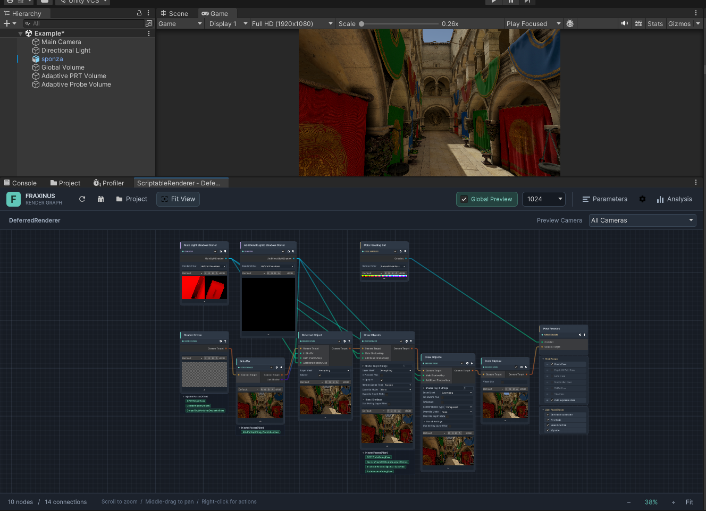

# FraxinusGraphics 2.0

[English](README.md) | [简体中文](README.zh-CN.md)

**在 Unity 2022.3 中，直接编辑一帧画面如何被渲染。**

FraxinusGraphics 2.0 以独立渲染管线 **UltraRP** 为核心。它把阴影、几何绘制、光照和后处理组织成可编辑的 **Renderer Graph**，把各阶段的输出放回节点中预览，让渲染流程的修改和画面调试发生在同一张图里。

在这套工作流之上，UltraRP 集成了 Hybrid Lit、实时矩形面光、APV / APRTV 探针光照、STP / SGSR 超分辨率和流式虚拟纹理。项目从 Fraxinus Engine 的 Unity 6 分支移植，面向 **Unity 2022.3.62f3**，无需安装 URP。

[安装与使用](docs/Usage.zh-CN.md) · [相对 1.x 的变化](docs/ChangesFrom1.x.md) · [本地依赖配置](docs/manifest.local.json) · [Git 依赖配置](docs/manifest.git.json)

*Sponza 场景与 Deferred Renderer Graph：上方是最终画面，下方是渲染节点、资源连线和中间结果预览。点击图片可查看原图。*

## 从最终画面追溯渲染过程

图中的阴影图和颜色分级 LUT 通过端口连接到使用它们的节点；GBuffer、延迟光照、物体绘制、天空与后处理共同构成画面的生成过程。节点里的纹理预览让这些连接具有可见的结果：当颜色或阴影出现异常时，可以沿着流程检查变化从哪一步开始，并选择预览来源相机、纹理和 RGBA 通道。

这张图也直接用于调整渲染。例如，要在延迟光照后补充一组 ForwardOnly 材质的绘制，可以接入 DrawObjects 节点，配置 Shader Tags、绘制队列和 Layer Mask，再把颜色与深度目标传给后续阶段。流程连接、绘制条件和阶段输出都能在图中一起查看；项目特有的处理则通过自定义节点或 Pass 注入扩展。

Renderer Graph 支持 Forward、Forward+、Stencil Deferred 与 Clustered Deferred。需要分辨率不同的中间结果时，**嵌套 Context** 可以为同一相机视角建立独立颜色、深度和帧数据，再显式合成回父目标。底层 Fraxinus Core RenderGraph 管理 Pass 与资源依赖，图编辑器负责组织这些渲染阶段。[渲染图与 Context](Packages/FraxinusRP/Documentation~/ScriptableNode.md)

## 与 URP、HDRP 的具体区别

**URP 侧重通用渲染与 Renderer Feature 扩展，HDRP 提供面向高保真画面的完整功能体系，UltraRP 则把整帧流程的可编辑性作为主要工作流。** 以下以同一引擎代际的 **Unity 2022.3 / URP 14 / HDRP 14** 为基准，比较各自的内置能力。

| 比较项 | 官方 URP 14 | 官方 HDRP 14 | UltraRP |
| --- | --- | --- | --- |
| **渲染流程编辑** | 主流程由 Renderer 实现，通过 Renderer Feature / Pass 注入扩展 | 主流程由管线实现，通过 Custom Pass 注入绘制或全屏处理 | 在 Renderer Graph 中连接绘制阶段与资源，可扩展节点、嵌套 Context |
| **中间结果查看** | 使用 Frame Debugger、Rendering Debugger 等独立调试工具 | 使用 Frame Debugger、Rendering Debugger 等独立调试工具 | 节点内直接预览阶段纹理与 RGBA 通道，同时保留 Render Graph Viewer / Rendering Debugger 入口 |
| **实时面光** | Rectangle / Disc 仅用于烘焙 | 支持实时 Rectangle / Tube，Rectangle 可投射阴影 | LTC 实时矩形面光，每相机最多 16 盏，当前无面光阴影 |
| **自适应探针** | 使用传统 Light Probe Groups，无 APV | 实验性 APV，支持自动布点、流式加载与光照场景混合 | APV 配合独立 Compute 烘焙器，支持布点、天空遮蔽与漫反射反弹，无需 DXR |
| **灯光变化后的间接光** | 预计算 Enlighten 实时 GI | SSGI / RTGI，或预烘焙光照场景切换与混合 | APRTV 在预计算传输数据上响应方向光与 HDR 天空变化 |
| **抗锯齿与超分辨率** | TAA；FSR 1 空间超分 | TAA Upscale、DLSS、FSR 1 等 | TAA、FSR 1，以及 STP、SGSR1 空间超分和 SGSR2 时序超分 |
| **流式虚拟纹理** | 无官方 SVT 渲染集成 | 原生 SVT + Shader Graph；透明图回退为普通采样 | 原生 SVT + UltraRP Lit / Unlit Shader Graph；支持路径包含透明材质反馈 |

这些差异对应不同的开发需求：沿用官方 URP 生态、在既有流程中追加效果，可以继续使用 Renderer Feature；需要面光阴影、SSGI / RTGI 等高保真功能，HDRP 提供了更完整的现成路径。UltraRP 的价值在于，当项目需要重新组织绘制阶段、组合前向与延迟材质，或检查某个阶段的输入输出时，可以直接围绕 Renderer Graph 工作，并在 Unity 2022.3 上使用 APRTV、STP / SGSR 等配套功能。

官方能力参照 [Unity 2022.3 功能对照](https://docs.unity3d.com/2022.3/Documentation/Manual/render-pipelines-feature-comparison.html)、[URP Pass 扩展](https://docs.unity3d.com/Packages/com.unity.render-pipelines.universal@14.0/manual/renderer-features/intro-to-scriptable-render-passes.html)、[HDRP Custom Pass](https://docs.unity3d.com/Packages/com.unity.render-pipelines.high-definition@14.0/manual/Custom-Pass.html)、[HDRP 超分辨率](https://docs.unity3d.com/Packages/com.unity.render-pipelines.high-definition@14.0/manual/Dynamic-Resolution.html)及 [SVT 材质支持](https://docs.unity3d.com/2022.3/Documentation/Manual/svt-use-in-shader-graph.html)。

## 从材质受光到场景间接光

**Hybrid Lit** 沿用 Lit 的材质工作流，通过 rough diffuse、GGX、微阴影和 FGD 环境反射处理表面受光，并支持 Clear Coat。LTC 矩形面光让光源尺寸参与漫反射和高光计算；GTAO 与主光 Contact Shadows 补充遮蔽和接触细节，直方图自动曝光负责亮度适应。这些功能共同服务于材质与场景的光照表现，按所选渲染路径启用。[Hybrid 光照](Packages/FraxinusRP/Documentation~/HybridLighting.md) · [GTAO](Packages/FraxinusRP/Documentation~/AmbientOcclusion.md) · [接触阴影与曝光](Packages/FraxinusRP/Documentation~/ContactShadowsAndExposure.md)

场景间接光可以使用 **APV** 烘焙探针，也可以选择 **APRTV** 预计算传输。在几何和材质不变的场景中，APRTV 能随方向光和 HDR 天空变化更新探针光照，适合探索不同太阳方向、光色和天空环境。它依赖预计算的静态场景数据，几何或材质变化需要重烘，当前不处理动态遮挡。APV 烘焙所需的射线查询由 Light Transport 的 Compute 路径提供。[APV 烘焙](Packages/Fraxinus-RPCore/Documentation~/StandaloneAPVBaking.md) · [APRTV](Packages/Fraxinus-RPCore/Documentation~/APRT.md)

## 材质创作与画面重建

材质既可以使用手写 Shader，也可以通过 **UltraRP Lit / Unlit Shader Graph Target** 创作；配套 Target 同时生成阴影、深度、法线、Meta 和运动矢量等辅助 Pass。对于需要纹理流送的材质，可使用 Texture Stack 与原生 **SVT**，由可见纹理页反馈驱动加载，并配置 CPU / GPU 缓存预算。[Shader Graph](Packages/FraxinusRP/Documentation~/ShaderGraph.md) · [SVT](Packages/FraxinusRP/Documentation~/VirtualTexturing.md)

渲染分辨率可以独立于最终输出选择。**SGSR1** 从单帧重建图像，**SGSR2** 利用运动矢量与相机历史进行时序重建，另有 **STP** 可选；它们与 Render Scale、后处理和历史重置一起接入管线，方便在同一场景中比较不同重建方式的表现。[超分辨率配置](Packages/FraxinusRP/Documentation~/Upscaling.md)

## 四个包的分工

| 包 | UPM 标识 | 版本 | 职责 |
| --- | --- | --- | --- |
| [FraxinusRP](Packages/FraxinusRP/README.md) | `com.bluewhitebow.fraxinus-rp` | `0.1.0` | ScriptableNode、UltraRP、渲染节点与材质／光照集成。 |
| [Fraxinus-RPCore](Packages/Fraxinus-RPCore/README.zh-CN.md) | `com.unity.render-pipelines.core` | `14.0.99` | RenderGraph、共享渲染工具、探针烘焙与数据管理。 |
| [Fraxinus-ShaderGraph](Packages/Fraxinus-ShaderGraph/FraxinusChanges.md) | `com.unity.shadergraph` | `14.0.12` | 为 UltraRP Target 开放所需内部 API 的 Shader Graph 分支。 |
| [Fraxinus-Light-Transport](Packages/Fraxinus-Light-Transport/README.zh-CN.md) | `com.fraxinus.rendering.light-transport` | `1.0.1` | Compute 射线查询、加速结构与采样。 |

**2.0 是套件名称，各 UPM 包保留自己的版本号。** 四个包应来自同一份 checkout 或同一个 Git 提交；版本号相同不代表官方包与定制分支可以互换。

## 开始使用

1. 将本仓库放在 Unity 工程的同级目录，将 [manifest.local.json](docs/manifest.local.json) 的 `dependencies` 合并到工程的 `Packages/manifest.json`，保留工程其他依赖。Git 安装方式见[使用指南](docs/Usage.zh-CN.md)。
2. 用 **Unity 2022.3.62f3** 打开使用这些包的工程，等待 Package Manager 完成依赖解析。
3. 通过 **Assets > Create > FraxinusEngine > UltraRP > UltraRP Asset** 创建管线资产及关联的 Renderer Graph，按[图配置说明](Packages/FraxinusRP/Documentation~/Installation.md)连接绘制、阴影与后处理节点。
4. 在 **Project Settings > Graphics** 指定 UltraRP 资产，检查当前 **Quality** 等级的覆盖设置。使用包内 UltraRP Shader，或通过 **Assets > Create > Shader Graph > UltraRP** 创建 Lit / Unlit 图。

本仓库提供包和文档；Editor 应打开引用这些包的 Unity 工程。FraxinusRP 当前不发布示例场景或示例生成器。

## 支持范围与验证

- **依赖**：Core 与 Shader Graph 沿用 Unity 包 ID，会替换相应官方包。UltraRP 需要配套分支；官方 Shader Graph 即使同为 `14.0.12`，也不包含所需内部 API 访问权限。
- **光照路径**：Hybrid Lit 与 Shader Graph Lit / Unlit 通过 Forward / ForwardOnly 绘制。矩形面光支持文档所列 Forward 路径及普通 Lit 的 Clustered Deferred；不包含 Stencil Deferred 和 Shader Graph 面光接收路径。
- **图与材质扩展**：`JobGraphProcessor` 当前使用同步后备实现；高级 Shader Graph Target 和 VFX 集成仍有隔离项。项目自定义节点需要按 [IL2CPP 指南](Packages/FraxinusRP/Documentation~/IL2CPP.md)配置反射保留。
- **平台与纹理**：SVT 属于 Unity 实验性功能，XR、硬件动态分辨率和子 Context 等路径不收集反馈。其他功能也有各自的相机与平台范围，请以功能文档为准。

配置检查与各模块的测试入口见[验证说明](docs/Validation.md)。具体功能的测试环境和支持范围以对应包文档为准。

## 来源与许可证

仓库结构参考 [FraxinusGraphics](https://github.com/bluewhitebow/FraxinusGraphics)，源码来自 Fraxinus Unity 2022.3 开发工程。各包的来源提交见 [PackageSources.json](docs/PackageSources.json)。

许可证与第三方声明保留在各自包中，未重新指定统一许可证。参见 [Core 许可证](Packages/Fraxinus-RPCore/LICENSE.md)、[Shader Graph 许可证](Packages/Fraxinus-ShaderGraph/LICENSE.md)、[Light Transport 许可证](Packages/Fraxinus-Light-Transport/LICENSE.md)及 [Hybrid 光照来源说明](Packages/FraxinusRP/ShaderLibrary/Lighting/README.md)。Hybrid 光照部分算法适配自 IllusionRP，其中包含源于 Unity HDRP 的算法。
